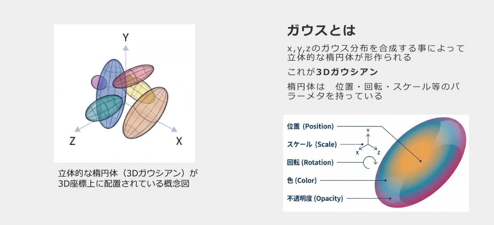

# 3DGS Demo

https://spoon-inoue.github.io/3dgs-demo/

Three.jsでは`r186`（2026.09.08）から、3DGSを扱えるようになった。

## 3DGSとは

> 3DGS（3D Gaussian Splatting、3D ガウシアン スプラッティング）とは、写真や動画から、実在の空間や物体を色と不透明度を持つ無数のガウス分布（ぼやけた楕円体）の集まりとして再構成し、フォトリアルな3Dをリアルタイムに描画する技術。
>
> [3Dガウシアンスプラッティング完全ガイド：サービス比較・活用事例・Webビューワー（2026年版）](https://www.utsubo.com/ja/blog/gaussian-splatting-guide)

> 
>
> [3DGS完全に理解した](https://www.docswell.com/s/masanaga/Z4489W-2026-01-19-224429#p13)

> 
>
> [初心者も挑戦！3D Gaussian Splattingで作るリアル3Dモデリング入門](https://developer.mamezou-tech.com/robotics/3dgs/3dgs-beginners-guide/)

## サンプル

- [Three.js sample](https://threejs.org/examples/?q=Gaussian#webgpu_gaussian_splat)
- [金輪寺 内観](https://superspl.at/scene/06abb7df)
- [Xポスト（知ったきっかけ）](https://x.com/makoto_krieger/status/2111233776827445603?s=20)

## 用途

- 雑貨などのプレビュー
- 建築計画
  - [今こそ知りたい3D Gaussian Splatting](https://www.youtube.com/watch?v=9VH3vnffgvo)
- インフラ維持管理、災害記録、遺跡・文化財のデジタルアーカイブ
- ライブのリアルタイム3D視聴（4DGS）

## 工程

1. 撮影
    - 特徴点を色んな角度から捉えるように撮る
    - LiDARを使ってより精細な表現をすることも可能
2. サンプリング
    - 楕円群の生成
    - 機械学習（ディープラーニングではない？）
    - ply: 非圧縮ファイル, `spz`: 圧縮ファイル
3. 描画
    - Three.js, Unity, Unreal Engine, previewサイトなど
    - WebGPUのCompute Shaderで`深度ソート`する

## ツール

- [Scaniverse](https://apps.apple.com/jp/app/scaniverse-3d-scanner/id1541433223)
  - スマホ（iOS）で撮影、サンプリング、圧縮ファイル（spz）のエクスポートまでできる。無料。Androidはサンプリングが上手くいかなかった。
- [postshot](https://www.jawset.com/)
  - 無料でも使えるけど、実質有料。ローカルで動く。学習にcudaを使うためwindowsのみ。動画ファイルをimportしてサンプリング、編集などができる。
- [SPARK](https://sparkjs.dev/)
  - Three.js用の3DGSレンダリングライブラリ。(現状は、Three.jsにAddonとして内包されているライブラリを使う？)

PCで動画ファイルから無料で作成する
1. 動画ファイル（mp4, mov）から、FFmpegなどで画像を抽出する
2. [COLMAP](https://github.com/colmap/colmap)で点群を生成する
3. [LichtFeld Studio](https://github.com/MrNeRF/LichtFeld-Studio)で学習する
    - windowsのみ
    - [SplatReady](https://github.com/jacobvanbeets/SplatReady)は、1, 2を自動化してくれる
4. [SuperSplatエディタ](https://superspl.at/editor)でノイズ除去

## 参考

- [3Dガウシアンスプラッティング完全ガイド：サービス比較・活用事例・Webビューワー（2026年版）](https://www.utsubo.com/ja/blog/gaussian-splatting-guide)
- [3DGS完全に理解した](https://www.docswell.com/s/masanaga/Z4489W-2026-01-19-224429)
- [3D Gaussian Splatting の概要](https://note.com/npaka/n/ncd4b84c1e2eb)
- [今こそ知りたい3D Gaussian Splatting](https://www.youtube.com/watch?v=9VH3vnffgvo)
- [初心者も挑戦！3D Gaussian Splattingで作るリアル3Dモデリング入門](https://developer.mamezou-tech.com/robotics/3dgs/3dgs-beginners-guide/)
- [Three.jsでの3Dガウシアンスプラッティング入門](https://ics.media/entry/260917/)
- [IZUTSUYA INC.](https://izutsuya.io/)
